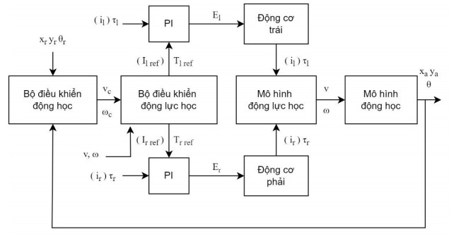
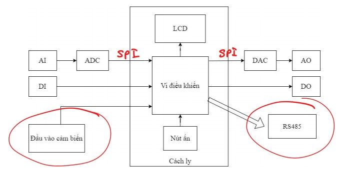
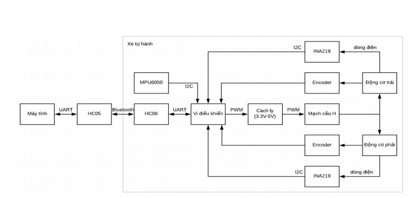

# Project Final Thesis

Brief summaries of the graduation reports in this repository:

## Autonomous Vehicle Controller (2023)

**Year:** 2023  
**Authors:** Truong Ba Binh and Tran Duc Long

Develops a mathematical model and trajectory-tracking controllers for a two-wheel-drive autonomous vehicle. It evaluates state-feedback and sliding-mode dynamic controllers alongside OSA-, genetic-algorithm-, and fuzzy-logic-based motor-current controllers. Matlab/Simulink results assess tracking of a circular path.

[Read the PDF](Three-wheeled%20vehicle.pdf)

## Temperature Control System (2022)

**Year:** 2022  
**Authors:** Tran Duc Long, Tran Hoai Lam, Nguyen Duc Ha, and Pham Hoang Anh

Designs a temperature control embedded system for industrial process control, integrating analog/digital I/O, PID control, relay output switching, RS485 communication, and an LCD interface. The project covers hardware architecture, signal conditioning, and software control logic for heating and cooling operation using thermocouple and RTD inputs.

[Read the PDF](Temperature_Embedded_System.pdf)

## Self-Balancing Two-Wheeled Vehicle (2020)

**Year:** 2020  
**Authors:** Pham Quang Toi and Pham Minh Hoang

Designs and tests balance control for a two-wheeled self-balancing vehicle. The report compares adaptive backstepping with LQR control and adds an input-disturbance observer to improve response to external loads. Simulations and experiments show the vehicle maintaining balance, including under a 500 g load.

[Read the PDF](SELF-BALANCING%20TWO-WHEELED%20VEHICLE.pdf)